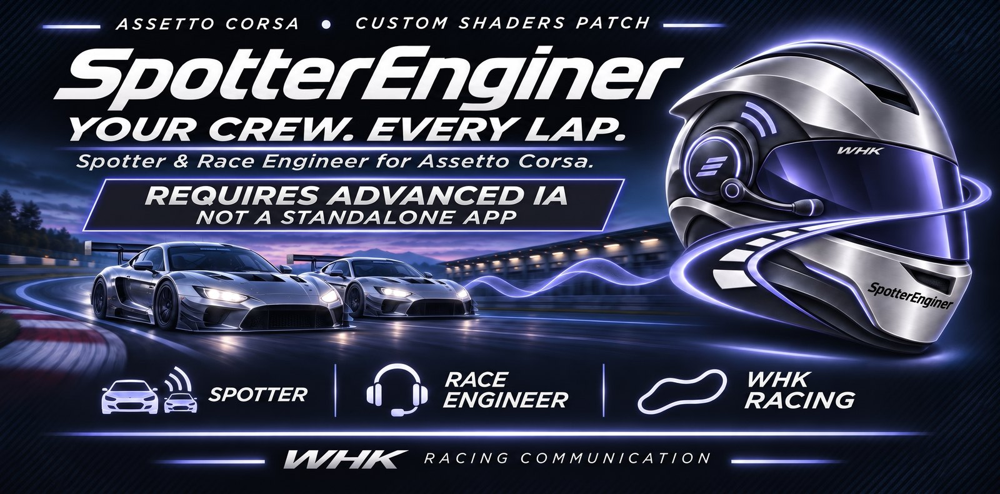

# SpotterEnginer

**Your crew, every lap: a voice spotter and race engineer for Assetto Corsa, built on AdvancedIA.**

SpotterEnginer is a Lua app for Assetto Corsa running on Custom Shaders Patch (CSP). It talks to you on the radio, in French or in English, with two separate roles:

- a **spotter**: race control, traffic and the cars around you;
- an **engineer**: pace, fuel, tyres, brakes, conditions, driving advice and pit strategy.

It also draws three in-game overlays: **Spotter**, **Engineer** and **Strategy**.

> **Requires AdvancedIA (Beta 1.46 or later) — not a standalone app.**
> SpotterEnginer reads the race state decided by [AdvancedIA](https://github.com/VincentChevalier44/AdvancedIA) (flags, neutralisations, delta, penalties, pit window, AI sanctions and stops). Without AdvancedIA installed **and** running, it says nothing.

- **Current version:** 1.3.2. See [CHANGELOG.md](CHANGELOG.md) and [COMPATIBILITY.md](COMPATIBILITY.md).
- **Voices:** French and English.
- **Interface:** French and English (setting **Language**, which sets the voice and the interface together). French on a first installation.
- **Author:** Vincent Chevalier / LHK Informatique.
- **License:** MIT License, see [LICENSE](LICENSE).

## Contents

- [Requirements](#requirements)
- [Installation](#installation)
  - [With Content Manager](#with-content-manager)
  - [Manual installation](#manual-installation)
  - [First launch](#first-launch)
- [Updating](#updating)
  - [From the app](#from-the-app)
  - [Compatibility guard](#compatibility-guard)
  - [Updating by hand](#updating-by-hand)
  - [What is kept across updates](#what-is-kept-across-updates)
- [Uninstalling and resetting the settings](#uninstalling-and-resetting-the-settings)
  - [Uninstalling](#uninstalling)
  - [Stopping the app without uninstalling](#stopping-the-app-without-uninstalling)
  - [Resetting the settings](#resetting-the-settings)
- [Working with AdvancedIA](#working-with-advancedia)
  - [Link states](#link-states)
  - [AdvancedIA versions and folder](#advancedia-versions-and-folder)
- [Features](#features)
  - [The settings window](#the-settings-window)
  - [Overlays](#overlays)
  - [AC app desktops](#ac-app-desktops)
  - [Spotter](#spotter)
  - [Engineer](#engineer)
  - [Strategy overlay and calls](#strategy-overlay-and-calls)
  - [Pit stops: a single reference](#pit-stops-a-single-reference)
  - [Strategy rules](#strategy-rules)
  - [Reactivity](#reactivity)
  - [Message pacing](#message-pacing)
  - [Voices and radio](#voices-and-radio)
- [Settings overview](#settings-overview)
  - [Settings reference](#settings-reference)
- [Honest limitations](#honest-limitations)
- [What to check in your first session](#what-to-check-in-your-first-session)
- [Session log](#session-log)
- [Troubleshooting](#troubleshooting)
- [Development and tests](#development-and-tests)
- [Changelog, license and credits](#changelog-license-and-credits)

## Requirements

- **Assetto Corsa** for PC.
- **Custom Shaders Patch 0.3.2 or later**, with Lua apps working (the app lives in `assettocorsa/apps/lua/`).
- **AdvancedIA Beta 1.46 or later**, installed in `assettocorsa/apps/lua/AdvancedIA/` (or in the old `apps/lua/ACAdvancedIA/` folder for installations not yet migrated) and running. Some calls need a more recent AdvancedIA: see [COMPATIBILITY.md](COMPATIBILITY.md).
- **Offline sessions only.** AdvancedIA does nothing online, so SpotterEnginer stays silent there too.

## Installation

The game loads the app from `assettocorsa/apps/lua/SpotterEnginer/`. The folder name must be exactly `SpotterEnginer`: AdvancedIA only opens its data bridge when `apps/lua/SpotterEnginer/manifest.ini` exists, and CSP stores the app's settings under that name.

Install AdvancedIA first (see its [README](https://github.com/VincentChevalier44/AdvancedIA)).

### With Content Manager

1. Close Assetto Corsa.
2. Download the latest `SpotterEnginer-<version>.zip` from the [Releases page](https://github.com/VincentChevalier44/SpotterEnginer/releases). A `.sha256` file is published next to it to check the download.
3. Drag the zip onto the Content Manager window and confirm the installation, or extract it straight into the `assettocorsa` root folder.

The package already has the right structure (`apps/lua/SpotterEnginer/…`). It holds only what the game loads (entry point, manifest, icon, `src/`, `sounds/`, `vox/`, `fonts/`) plus the user notes (`README.md`, `CHANGELOG.md`, `COMPATIBILITY.md`, `LICENSE`).

### Manual installation

1. Close Assetto Corsa.
2. On this GitHub page, click **Code › Download ZIP**, then extract the archive. It contains a folder named `SpotterEnginer-main`.
3. Copy that folder into `assettocorsa/apps/lua/` and **rename it exactly `SpotterEnginer`**.
4. Check the final path: `assettocorsa/apps/lua/SpotterEnginer/manifest.ini`.

The repository download also contains the test bench, the tools and the documentation (`tests/`, `tools/`, `docs/`). The game never loads them, so they can stay. `docs/icon-512.png` (the official 512 × 512 icon) and `docs/banner.jpg` are optional: the game uses `icon.png`.

### First launch

1. **Enable the app** among the CSP Lua apps.
2. **Start an offline session** with AdvancedIA enabled. The link chip in the header of the settings window reads **Connected to AdvancedIA** once both apps run (see [Link states](#link-states)).
3. **Open SpotterEnginer** from the apps bar to reach its settings. The window is also available in the setup menu.
4. **Language.** The voices and the interface are in French on a first installation. Change **Language** (tab **Radio & voice**, section **Voice and language**, or in the header) to **EN**.
5. **The three overlays** (Spotter, Engineer, Strategy) are drawn in game by the app, like those of SuperHUD and AdvancedIA. Only the settings window appears in the apps bar. Set them up in the **Overlays** tab (see [Overlays](#overlays)).
6. **Test the voice** on the **Home** tab (buttons **Spotter** and **Engineer**), next to the volumes.

## Updating

### From the app

New in 1.1.0. Since 1.2.0, as in AdvancedIA:
- the **header** shows the installed version; when a newer one is published, the version turns blue and a small **Update · x** button appears next to it (active when stopped, greyed while driving);
- if AdvancedIA must be updated first, the header shows an **AdvancedIA first** warning instead, and a click opens the **Diagnostics** tab;
- during the download and installation, the header shows the current step;
- the full **UPDATE** block (state, release notes, **Check now**, **Roll back**, **Check for updates at launch**) sits at the top of the **Diagnostics** tab.

**From 1.1.0 or 1.1.1, install 1.2.0 by hand once** (see [Updating by hand](#updating-by-hand)): in those versions the **Update** button of the block stayed greyed even when stopped. From 1.2.0 on, the in-app update works.

**Checking.** About ten seconds after the app loads, once per launch, the app makes one request to GitHub (`api.github.com`) to read the latest published release of this repository. Untick **Check for updates at launch** (UPDATE block, Diagnostics tab) to never contact GitHub. **Check now** asks again, at most once a minute.

When a newer version exists, the header button installs it in one click, and the block shows the installed version, the available one with its publication date and the first lines of its release notes, plus **Release notes** (opens the release on GitHub) and **Update**.

**Installing.** One click on **Update**, **only when stopped**: at your pit box at a standstill (not driving in the pit lane), or with the game paused. While you drive the button is greyed and the block reads *Available when stopped: pit box or pause*. Then the app:

1. downloads the release's `SpotterEnginer-x.y.z.sha256` digest, then `SpotterEnginer-x.y.z.zip`, from the repository's release downloads only (no other address is followed);
2. checks the download size, the SHA-256 digest, the package content (every path under `apps/lua/SpotterEnginer/`, no unsafe path, the essential files present, the updater itself included, and every `src/` module the code requires) and the version written in its `manifest.ini`;
3. checks that the package works with the installed AdvancedIA (see [Compatibility guard](#compatibility-guard));
4. extracts it into its work folder and compares the extracted copy with the package;
5. on the next frame you are still stopped: backs up the installed files that the update replaces, writes a marker, then copies the new files into the app folder **file by file** (each one written next to its destination, then swapped in at once; `src/` first, `SpotterEnginer.lua` next, `manifest.ini` last), keeps the version you had for **Roll back**, stops the radio, gives the car sound back, saves the settings and **restarts the app** (*x installed. The radio stops and the app restarts.*).

Until the copy starts, **Cancel** stops everything and the app folder is never touched. If you drive off while the package is ready, the copy is postponed: the package is kept, click **Update** again once stopped.

**Safety nets.**
- A failed copy puts the installed version back at once (*Cannot write to the app folder: current version kept*). If that fails too, the block reads *Recovery impossible: restart the game; if the problem stays, reinstall the app*.
- An install cut short by a crash or a power cut is **finished or undone at the next launch**, before anything else loads: from the extracted package when it is complete, otherwise by putting the starting version back. Two attempts at most, never a loop. The block then reads *Installation interrupted (game closed or crash): … restored at launch*.
- A freshly installed version that **fails to start twice** in a row is rolled back automatically at the next launch.
- **Roll back to x** puts the previous version back the same way (only when stopped, only when the kept version is complete, and only when it was saved from under the version now installed: after a manual install over it, the button is no longer offered).
- Other messages: *GitHub unreachable: check the connection*, *GitHub refuses for now (request limit): try again in an hour*, *Published release is incomplete on GitHub: try again later*, *Corrupted file: update cancelled, current version kept*.
- With a CSP version that lacks network or file access, the block reads *Updating from the app is not available here*: update by hand (below).

**Work folder.** Everything is prepared in CSP's state folder, `Documents/Assetto Corsa/cfg/extension/state/SpotterEnginer-update`, never in the app folder (CSP reloads the app as soon as one of its files changes). It holds `next/` (the extracted package), `current/` (the files about to be replaced), `backup/` (the previous version) and small state files (`installing.txt`, `updated.txt`, `boot.txt`, `failed.txt`). Once a new version has started properly, the leftovers are tidied away; `backup/` is kept.

**Pit plan for AdvancedIA (new in 1.2.0, contract v1).** SpotterEnginer also publishes its pit plan (`ac.store` key `SpotterEnginer.pitplan`): `v=1;lap=<N>;compound=-;state=planned|boxnow|done|none;window=<a>-<b>;boxcalls=0|1;stamp=<s>`, 160 characters at most. From AdvancedIA Beta 1.59, its pit overlay follows this plan: a short notice when the window opens, then *box this lap* only on the planned lap.
- `lap`: the lap in progress when entering the pits (the lap of the engineer's "box", fixed once "box next lap" is said).
- `compound`: always `-`, since the strategy model does not choose a compound; AdvancedIA's own rules stay the reference for tyres.
- `state`: `planned` once the plan is ready (never on the estimates of the first laps); `boxnow` on the planned lap from 10 % of the lap, or when a stop under neutralisation is called; `done` after the pit lane, until a next stop is planned; `none` without a ready plan, outside races, or with the engineer or strategy off.
- `window`: the engineer's pit window; `boxcalls`: whether the "box" calls are said on the radio.
- `stamp`: simulation time in whole seconds; AdvancedIA treats the plan as frozen when it stops moving for 6 s (paused: neither clock moves) and starts over when it goes back.

**For AdvancedIA's home page.** SpotterEnginer publishes its update state in the game's shared memory (`ac.store` key `SpotterEnginer.update`, contract v1): `v=1;installed=…;latest=…;state=available|uptodate|checking|error|incompatible[;needs=…]`. `needs` gives the AdvancedIA version the package requires.

Do not update the app in the middle of a race by hand either: CSP reloads it, and the states in progress are announced again.

### Compatibility guard

SpotterEnginer only works with AdvancedIA, so it never installs a version that would leave the spotter mute. Before installing, and before rolling back, it compares the bridge version of the package (`src/bridge_layout.lua`, `L.version`) with the one of the installed AdvancedIA:

| Situation | Result |
|---|---|
| Same bridge version | Installed. |
| AdvancedIA older than the package expects | Refused: *Update AdvancedIA first: x expects a newer bridge (AdvancedIA … or later).* |
| AdvancedIA newer than the package knows | Refused: *The installed AdvancedIA publishes a newer bridge than x knows: wait for a SpotterEnginer version that supports it.* |
| AdvancedIA not installed | Refused: *AdvancedIA not found: SpotterEnginer only works with it. Install AdvancedIA, then try again.* |

The AdvancedIA version a package needs comes from its manifest (`REQUIRES_ADVANCEDIA`, `Beta 1.46` for 1.1.0 to 1.3.2). A bridge change always ships in both apps together: see [COMPATIBILITY.md](COMPATIBILITY.md).

### Updating by hand

For a first install, or when the in-app update is unavailable:

1. Close Assetto Corsa.
2. Download `SpotterEnginer-x.y.z.zip` from the [Releases page](https://github.com/VincentChevalier44/SpotterEnginer/releases) (check it with its `.sha256` if you like).
3. Extract it into the `assettocorsa` root folder, replacing the existing files (the zip contains `apps/lua/SpotterEnginer/…`), or drag it onto Content Manager.
4. Start the game.

### What is kept across updates

- **Your settings**: they live in CSP's storage (`ac.storage`), written to `Documents/Assetto Corsa/cfg/extension/state/lua/app/SpotterEnginer.ini`, not in the app folder.
- **Settings migrate automatically.** When a default changes, values still on the old default follow the new one; a value you set yourself is kept:
  - settings version 2: **DRS by voice** off by default (AdvancedIA already has its beep and its panel);
  - settings version 3: **Master volume** 170 % and **Car sound during the radio** 85 % (from 100 % and 40 %).

## Uninstalling and resetting the settings

### Uninstalling

1. Close Assetto Corsa and delete the folder `assettocorsa/apps/lua/SpotterEnginer`. Without it, AdvancedIA no longer opens its bridge.
2. Optionally, delete what the app left in your Documents folder:
   - its settings: `Documents/Assetto Corsa/cfg/extension/state/lua/app/SpotterEnginer.ini`;
   - its session logs: `Documents/Assetto Corsa/logs/SpotterEnginer.log` and `SpotterEnginer.1.log` to `SpotterEnginer.3.log`;
   - its update work folder: `Documents/Assetto Corsa/cfg/extension/state/SpotterEnginer-update`.

The car sound lowered during the radio is a multiplier on your car that CSP never saves, so there is nothing else to undo.

### Stopping the app without uninstalling

- **SpotterEnginer on** (switch in the header): off, no call is made and the overlays are idle.
- The **Spotter**, **Engineer**, **Strategy** and **Overlays** tiles on the **Home** tab switch each role on or off.
- Each section has its own switch (see [The settings window](#the-settings-window)).
- **Mute the radio** (tab **Radio & voice**) or **Ctrl+Alt+M** mutes the radio for the session.

### Resetting the settings

| What | Where | What is kept |
|---|---|---|
| One setting | Right-click the setting | Nothing: back to its default |
| One section | **Reset** in the section header (shown when a setting there is changed) | The other sections |
| Everything | **Diagnostics › Reset all settings (overlays: this desktop)**, confirmed by a second click | The language, and the overlays of the other desktops |
| Factory reset | Close the game and delete `SpotterEnginer.ini` (see above) | Nothing |

## Working with AdvancedIA

SpotterEnginer **only works with AdvancedIA**. It reads the state decided by AdvancedIA's engine through a data bridge between Lua apps (`ac.connect`; format in `src/bridge_layout.lua`, details in [docs/PONT_ACADVANCEDIA.md](docs/PONT_ACADVANCEDIA.md)):

- the flags and the driver's panel;
- neutralisations (SC, VSC, FCY), restarts, standing starts;
- the delta to keep;
- the player's penalties;
- the pit window and mandatory stops;
- the AI sanctions and pit plans.

Assetto Corsa's native flags are never used, because AdvancedIA imposes its own.

### Link states

Until AdvancedIA is connected **and** running, SpotterEnginer says nothing. It only shows the state of the link in its header and on the **Home** tab:

| State | Meaning |
|---|---|
| **Connected to AdvancedIA** | The spotter and the engineer work with the state decided by AdvancedIA. |
| **AdvancedIA suspended** · reason | AdvancedIA is paused, in a replay, online, disabled… (reasons: paused, replay, online race, app disabled, emergency stop, session finished, no section ticked, starting, no AI line, irregular frames, access refused). |
| **Waiting for AdvancedIA** | AdvancedIA is installed but not running: enable it in the CSP Lua apps, or wait for it to start. |
| **AdvancedIA stopped** | AdvancedIA was just unloaded. |
| **AdvancedIA without bridge** | The installed AdvancedIA version does not publish the bridge yet. |
| **Different bridge version** | AdvancedIA publishes another bridge version: update both apps. |
| **AdvancedIA missing** | AdvancedIA is not installed: no `manifest.ini` in `apps/lua/AdvancedIA` nor in the old `apps/lua/ACAdvancedIA`. |

### AdvancedIA versions and folder

- **The bridge is built into AdvancedIA since Beta 1.46** of AC Advanced AI (its former name), published on GitHub on 4 November 2026 (release v1.46) and offered by its built-in update from 1.45.
- **The app is called AdvancedIA from Beta 1.49** (GitHub repository VincentChevalier44/AdvancedIA). It installs into `apps/lua/AdvancedIA/` instead of `apps/lua/ACAdvancedIA/`. SpotterEnginer looks for the new folder first, then the old one for installations not yet migrated; only the `manifest.ini` counts (an empty old folder is ignored).
- **The bridge does not change with the rename**: same format, same `ac.connect` keys (`ACAdvancedIA.Bridge.Hello`, `ACAdvancedIA.Bridge.Data.v1`).
- **AdvancedIA only opens the bridge when `apps/lua/SpotterEnginer/manifest.ini` exists.** Its log (`Documents/Assetto Corsa/logs/AdvancedIA.log`, `ACAdvancedIA.log` before 1.49) confirms it with the line `pont des apps compagnes: ouvert (version 1)` (*companion app bridge: open*).
- With an AdvancedIA version without the bridge, SpotterEnginer shows **AdvancedIA without bridge** and stays silent.
- Since AdvancedIA does nothing online, SpotterEnginer is for offline play only.

## Features

### The settings window

The interface follows the **Racing 26** theme of the other apps (SuperHUD, SetupLab, AdvancedIA), in the colours of the app's helmet: the logo at the top left of the settings window, and a **periwinkle** accent (#A09BFF) instead of AdvancedIA's cyan. The fonts are bundled in `fonts/` (Barlow, Barlow Condensed, JetBrains Mono).

The window is organised like AdvancedIA's:

- **Header**: logo, name, version, current desktop, link state, **Radio muted** chip, language and the master switch.
- **Tabs at the top**: **Home**, **Spotter**, **Engineer**, **Strategy**, **Radio & voice**, **Overlays**, **Diagnostics**. An orange dot marks a role that is switched off.
- **Left column** (every tab except Home and Diagnostics): at the top, the role switch (spotter, engineer, strategy) and the number of active sections; below, the sections in groups. Each section has its switch and the number of its changed settings.
- **Right pane**: the chosen section, with its title, its **On** or **Off** chip (and the desktop, for the overlays), its switch, its description, **Reset** when a setting there is changed, then its settings.
- **A section switched off** says nothing of what it covers, but the choices made inside it are kept. Its settings stay visible, dimmed and editable, and come back as they were when you switch it on again.
- **Settings**: each setting has a default-value mark and a tooltip; a right-click restores its default.

**Sections:**

| Tab | Sections with a switch | Sections always on |
|---|---|---|
| Spotter | Flags and neutralisations, Delta to keep, DRS, Penalties, Side by side, Traffic, Pit exit, Gaps | — |
| Engineer | Pace and calls, End-of-race debrief, Fuel, Driving advice, Tyres, Brakes, Damage, Weather and grip, Wind into braking | — |
| Strategy | Strategy calls | Current plan, Wear and pace, Stop and rejoin |
| Radio & voice | Car sound during radio | Volumes, Voice and language, Message pacing, Radio log |
| Overlays | Common settings, Keyboard shortcuts, Spotter overlay, Engineer overlay, Strategy overlay | AC app desktops |

The sections that are always on have nothing to switch off: they set a calculation (the plan is always computed, the Strategy overlay needs it), volumes or the language, or they show a state. Switching **Strategy calls** off silences the "box", the undercut, the overcut and the car ahead pitting, but the Strategy overlay keeps the plan and the duels.

- **Home**: the link, the **Spotter**, **Engineer**, **Strategy** and **Overlays** tiles (each one switches its role on or off), the voice clips found, the volumes with the **Test the voice** buttons.
- **Diagnostics**: the **UPDATE** block, then state, bridge, errors, strategy model, desktop, settings, and **Reset all settings (overlays: this desktop)**, confirmed by a second click; the overlays of the other desktops are kept.

### Overlays

Same settings as in SuperHUD and AdvancedIA.

**For each overlay:**
- show or hide;
- lock;
- X and Y position in pixels, or AUTO;
- scale;
- background **Solid**, **Ghost** (38 % of the opacity) or **Transparent**;
- background and content opacity;
- decorative band (a line at the top, in the colour of the race state);
- header;
- **Recenter** and **Reset** buttons.

**For all overlays:**
- shown or hidden;
- click-through once locked;
- hidden in replays or in the pit lane;
- **Lock all** or **Unlock all**;
- **Make backgrounds transparent** or **Restore backgrounds**;
- number of lines and duration of the radio messages.

**In-game editing (new in 1.2.0, no pause menu or pits needed):**
- while driving, move the mouse: a small **OVERLAYS** button shows for 3 seconds at the top centre of the screen (not when you steer with the mouse: hover it, pause, or use Ctrl+Alt+K) (drag it elsewhere if you like; its position is kept);
- click it: the edit panel opens under the button and every overlay shown is unlocked for the edit;
- drag an overlay to move it, pull its bottom-right corner for the size; the overlay you touch is picked in the panel (thicker frame, name at the bottom);
- in the panel: show or hide each overlay of this desktop, then for the picked one its size, background (**Solid**, **Ghost**, **Transparent**), background and content opacity, decorative band, header and **Recenter**;
- **Done** (or **Ctrl+Alt+K**) closes the panel and locks every overlay. The edit itself is never saved as "unlocked": after a crash, everything is locked.
- Setting **In-game edit button** (section **In-game editing**, tab **Overlays**) hides the button; **Ctrl+Alt+K** still opens the panel.

**Placing an overlay from the settings window:** unlock it, drag it, pull its bottom-right corner for the size, then right-click to lock it. Unlocked, it stays visible even without AdvancedIA; locked, it only shows when AdvancedIA is connected.

**Keyboard shortcuts** (a setting; they avoid SuperHUD's H and G keys):
- **Ctrl+Alt+J**: show or hide the overlays of the current desktop;
- **Ctrl+Alt+K**: open or close in-game editing (closing locks every overlay);
- **Ctrl+Alt+M**: mute or unmute the radio for the session.

### AC app desktops

Like SuperHUD, each of CSP's 4 app desktops keeps its own overlays.

- **Per desktop**: overlays shown, positions, sizes, backgrounds, band, header, opacities, click-through, hiding in replays or in the pits, the overlay radio.
- **Shared by all desktops**: spotter, engineer, strategy, voices and volumes.
- Switch desktop with the game command **Next desktop** (CSP apps bar or a wheel button), then set it up in the **Overlays** tab, section **AC app desktops**: the current desktop is highlighted there, with the number of overlays shown on each one.
- **Copy this desktop to the others** and **Clear this desktop** are on the same page.
- A desktop never set up is empty. When updating from a version without desktops, the desktop you are on keeps the current configuration.

### Spotter

| Call | Source |
|---|---|
| Green flag (in full at the end of an SC, VSC, FCY or red flag; short, *"Green, yellow is over."*, when leaving a yellow zone, said the moment AdvancedIA shows the green), yellow and double yellow (with the distance to the zone), red, white (slow vehicle), slippery track, blue, black and white (final warning before disqualification), black with orange disc, black, chequered | AdvancedIA |
| Safety Car (called, then deployed), VSC, FCY, VSC ending in 10 s, SC in this lap, restart (rolling, behind the SC, under VSC or FCY after a red flag), session resumes | AdvancedIA |
| Standing start, formation lap, start from the pit lane, lights coming on, *"Go, go, go!"*, jump start, in position or past your grid slot, last lap | AdvancedIA's driver panel |
| Last lap with your position and advice, in one transmission: *"This is the last lap! You're P7."* then *"He's right behind you, close the door."* (car less than 0.8 s behind), *"He's within reach, give it everything!"* (car ahead less than 1.2 s away) or *"Bring it home, no risks."* | AdvancedIA's driver panel, AC's classification, measured gaps |
| Negative or positive delta under neutralisation and double yellow | AdvancedIA (the delta beep stays AdvancedIA's) |
| Give the place back (with the name), place given back; penalty by reason: delta, overtaking under a flag, red flag, stop not served, jump start; drive-through, back to the pits | AdvancedIA |
| Pit window open (with the engineer's optimal lap), stop waived in a wet race, pit lane closed, stint limit, track getting wet or drying | AdvancedIA and the engineer's plan (see [Pit stops: a single reference](#pit-stops-a-single-reference)) |
| F1 rules (AdvancedIA Beta 1.49): the mandatory stop only counts with another dry compound. *"Mandatory stop: change compound, or the stop won't count."* at the pit lane entry, on any lap while the stop is due, or *"Your pit strategy has the same compound. Change it, or the stop won't count."* (also at the start); then *"Stop validated, compound change counted."* or *"Stop not counted, same compound. The mandatory stop is still due."* The compounds (`SS → S`) are written on the overlay radio; the engineer's plan is solved again as soon as AdvancedIA has decided | AdvancedIA's pit notices |
| Restart (AdvancedIA Beta 1.50, race): *"Restart position: seven"* at the red flag in the pits, then at the pit lane exit on the relaunch lap (car to follow written, or *"behind the safety car."*); *"Take your place back: pass the car ahead."* when a car classified behind you is ahead (at most every 15 s, name written). The queue formed behind the Safety Car and the car right behind it are only written | AdvancedIA's restart announcements |
| DRS available, enabled, "enabled in N laps", disabled | AdvancedIA. **Off by default**: AdvancedIA already has its beep and its panel |
| Penalties of your direct rivals (two places ahead and behind): +N s, DT, SG, cut, disqualification; car disqualified | AdvancedIA's sanctions |
| Car left, car right, three wide, still there, clear | Car positions. A car counts as alongside from 1.3 m of lateral offset (not a car in your tow), after 0.25 s of overlap (not a brush); "clear" after 0.6 s of free lane, only if the side call was heard, and without cutting the engineer off. The side is checked against CSP's lateral track position; left and right are swapped automatically after repeated disagreement |
| Gaps ahead and behind in one message, every N laps, with *"You're closing."*, *"He's closing on you."*, *"He's pulling away ahead."*, *"You're pulling away, keep it up!"* or, in a fight, *"Gap is stable."*; under 10 s, "9.3 seconds" as a single clip; above, to the second | Timing at checkpoints |
| Backmarker ahead, faster traffic behind | Timing |
| Practice and qualifying: *"Car on a flying lap behind, let it through."* (name and measured gap written), while you are on an out-lap or a cool-down lap, only once the car is seen really closing in | AdvancedIA 1.51 (`fastCar` announcement), checked by Timing; setting **Faster traffic behind** |
| Pit exit clear, or traffic when rejoining | Exit point learnt on every car |
| Live gaps (new in 1.3.0, setting **Live gaps**): *"You're within a second, go for it!"* when the car ahead comes within a second (with *"Nothing behind, you can have a go."* in the same transmission when nobody is within 1.5 s behind), *"He's within a second behind, watch your mirrors!"* when the car behind does; once per car, again only after the gap has gone back above 1.4 s. From lap 2, never near the line (the gaps of the lap are said there) nor under neutralisation | Timing |
| Hazards ahead: called within 600 m as in 1.2.0, and from 1.3.0 earlier at high speed (11 s at your closing speed, up to 900 m): stopped car, car spinning, car going the wrong way, then its side and where to go: *"Stopped car ahead! It's on the left. Go right."*, *"Right on the racing line!"*, *"Off the track."* (then priority 2). The same car is not called again within 45 s. With **Anticipation** off: from 600 m only, as in 1.2.0 | AdvancedIA's state of every car (incident, spin, stopped, wrong way, on track), CSP's lateral track position |
| *"Contact between cars ahead, careful!"* (with **Anticipation**): two cars ahead (within 700 m) touch and one loses at least 25 km/h within 1.2 s beyond the braking it was already doing; a light rub, or a touch under braking, says nothing; never right after the hazard call of one of the two cars, nor for the car of AdvancedIA's yellow zone. Never "debris": AC does not simulate any | AC collisions (`collidedWith`) and speeds |
| AI mistake ahead | AdvancedIA's mistakes |
| *"Coming up on your left!"* (1.3.0, **Anticipation**): a car less than 19 m behind, one lane over, at least 8 km/h faster and still at least 0.8 s from being alongside (closer, *"Car left."* follows at once and is enough). Not on the first lap of a race (tight pack), never below 60 km/h | Car positions |
| *"You're clear, you can move over."* instead of *"Clear."* when the car that was alongside is now behind you (overtake completed) | Car positions |
| *"Nothing behind, you can have a go."* when you come within 0.6 s of the car ahead and nobody is within 1.5 s behind (once per attack, at most every 90 s) | Timing |
| Your emergencies (new in 1.3.0, section **Emergencies**): *"Contact!"* (name written) when a contact with a car costs you at least 6 km/h more than your braking was already taking off, or damage, at most every 15 s; after a spin, *"You've spun! Stay on the brakes, cars coming."* or *"You've spun. It's clear, go when you're ready."*, then *"Car coming, wait!"* and *"It's clear, go now."* until you are back above 50 km/h; *"You're stopped on track, watch the traffic."*; *"You're facing the wrong way! Turn around when it's clear."*; *"Careful rejoining, car coming!"* when you come back from off the track with a car less than 3 s away. Never on the grid, at the lights or under a red flag | AC collisions and speeds, AdvancedIA's state of your car (spin, wrong way, on track) |
| Track limits | AC's cut counter (AdvancedIA does not track them for the player) |

AdvancedIA's announcements are also written as text on the radio of the Spotter overlay (setting **AdvancedIA announcements on the radio**).

The 32 kinds of AdvancedIA announcement and the 40 states of its panel were reviewed one by one; every race event has its clip.

**Silent on purpose:**
- the lap information (`lap`);
- AdvancedIA's app update notice (`update`);
- "track clear" (`clear`, `none`);
- the DRS, by default (setting).

### Engineer

- **Pace**: delta to the target lap of the strategy model, comparison with the car you are chasing, *"You're losing time"*. The pace (median of the last three laps) only counts clean laps: a lap through the pit lane or under neutralisation is left out, for you and for your rivals.
- **Calls**:
  - push, defend or hold position;
  - overtake mode when the car has ERS, P2P or DRS;
  - fuel-saving engine map when fuel is short.
- **Position** (setting **Position and advice**, section **Pace and calls**): *"You're P5."* at the line when your place has changed since the last call, never every lap. It is a single transmission with the call of the lap: *"You're P4. Nice job. Push now, this is the moment."* Without another call, advice is added only when it is justified:
  - *"He's within reach, push a little, you can do it."* when the car ahead can be caught at the current pace before the finish;
  - *"Look after your tyres, take it a bit safer."* after overheating or abnormal wear, when nobody threatens from behind (once per stint).

  *"Nice job."* only for an overtake on track: a place gained during a rival's stop or from a retirement does not count. One call per crossing of the line. A call that could not be said (busy radio) is said at the next crossing; a position already said is said again if it changes again, even within three minutes.

  **Live position** (new in 1.3.0, setting **Live position**): a place gained on track is said straight away, once held for 2.5 s, with a motivating tone (*"You're P4. Great move, well done!"*); a place lost to a car that passed you on track too (*"You're P5. He got by. Stay calm, we'll get him back."*). A place taken or lost at a stop is left to the line. The same key and the same 40 s delay as the call at the line: never both.

  Nothing before the end of lap 2, under neutralisation or in the pit lane. On the out-lap, the position alone (*"You're P8."*). On the last lap, the spotter says it (see [Spotter](#spotter)); if the Spotter role or the **Flags and neutralisations** section is off, the engineer says it instead.
- **Fuel**: measured consumption, laps of fuel against the need (up to the planned stop or the finish), *"Save fuel, lift and coast."*, target plus or minus N laps.
- **Tyres**:
  - warm-up phase (core below the optimum), overheating (core or surface);
  - abnormal wear: one tyre clearly more worn, flat spot, blisters, graining, puncture.
- **Brakes**: overheating, bias advice when front and rear diverge (cars with adjustable bias).
- **Damage**: a hit recorded on the bodywork. From 1.3.0, after a contact or a big hit (*"Big hit! We're checking the damage."*: against a wall, damage recorded, or at least 30 km/h lost beyond your braking with the brake pedal released), the engineer gives a damage report 3.5 s later: *"No damage, you're fine, carry on."*, *"Light damage, you can carry on."*, *"Moderate damage, the car's hurt. We'll keep an eye on it."*, *"Heavy damage. Box, box."* or *"Suspension damage. Bring it back to the pits carefully."* (section **Emergencies**).
- **Puncture** (1.3.0, section **Emergencies**): *"Puncture! Bring it back to the pits slowly."* once per tyre, instead of "abnormal tyre wear".
- **Conditions**: rain expected in N minutes, rain getting heavier, grip dropping or rising.
- **Wind into braking**: tailwind or headwind at the start of a big braking zone.
- **End-of-race debrief** (new in 1.2.0, section **End-of-race debrief**): as soon as you cross the finish line of a race (even while AdvancedIA pauses its bridge for the finish) the spotter says *"Chequered flag, race over! You're P2."* Five seconds later the engineer sums it up in one transmission:
  - places gained or lost since the start (*"3 places gained since the start."*), or *"Same place as on the grid."*;
  - overtakes on track (*"7 overtakes on track."*), counted by SpotterEnginer: a car passed for position, never a backmarker being lapped, never a place gained in the pits;
  - *"And the fastest lap of the race!"* when it is yours;
  - a verdict: win, podium, top 5, top 10, good comeback (3 places or more gained), tough race (3 places or more lost), keep improving, not classified, disqualified.

  Written on the radio only: start and finish places, your best lap, how many times you were passed. The place is AdvancedIA's corrected classification (time penalties included) when there is one. If the Spotter role or the **Flags and neutralisations** section is off, the engineer starts with *"Race over. You're P2."*
- **Driving**: over 40 mini sectors, a repeated loss over three clean laps. Depending on the case: braking too early, corner speed too low, or time lost in a given sector (with the track's sector name when there is one).

### Strategy overlay and calls

The solution is computed again every lap, at every stop and at the start of a neutralisation (`src/strategy.lua`). It combines:

- **Real wear**: virtual km per lap on each axle, measured in the race. They already contain the driving style, the load, the track and the temperature. They are converted into grip lost through the car's wear curve (`WEAR_CURVE` of `tyres.ini`, `data.acd` included), then projected with the temperature trend: track, plus half of the air. Both temperatures and their trend are shown on the overlay.
- **Lap time loss**: sensitivity of the lap time to the grip lost, learnt by regression on your clean laps and corrected for fuel.
- **Fuel**: consumption, mass on board, tank capacity.
- **Stop**:
  - pit lane loss, measured on your stops **and** on the AI's: time in the lane, minus the stationary stop, minus the same stretch driven on track on the previous lap; the value can be set before the first measurement;
  - tyre change and refuelling (`car.ini [PIT_STOP]`);
  - minimum time from the rules.
- **AdvancedIA's rules**: mandatory stops and their window.
- **Traffic when rejoining**: the position of every car at the moment you would rejoin, computed from their pace and from the AI stops planned by AdvancedIA.

Shown and called:

- **pit window**: the laps whose total cost stays within 2 s (adjustable) of the optimum;
- **optimal lap** and number of stops;
- degradation and grip now and at the stop lap;
- expected position when rejoining;
- **undercut** and **overcut** on the car ahead, undercut **threat** from the car behind;
- chart of the cost by stop lap.

On the radio:

- *"Pit window from lap X to lap Y. Optimal lap: Z."*;
- *"Box next lap."*, then *"Box, box, this lap."*;
- a stop advised under neutralisation, when the loss is smaller;
- *"Car ahead is pitting."*

### Pit stops: a single reference

The stop lap is the one of the engineer's plan, computed inside AdvancedIA's regulatory window.

- **First laps**: the plan is computed and shown from the start (Strategy overlay: **Estimated model**, optimal lap greyed out), but the engineer calls nothing from it while it rests on estimates: no window, no optimal lap, no box, no undercut or overcut, no fuel to the stop and no target lap. It waits for two measured clean laps (the start lap never counts), or three laps seen by the app if the track is neutralised. The only exception is a stop that cannot wait (measured fuel for two laps or less). Meanwhile, the opening of the window is called by the spotter, without an optimal lap, and AdvancedIA's end-of-window reminder stays: a mandatory stop is never forgotten. The plan is then solved again every lap.
- **Window opening**: *"The pit window is now open. Optimal lap: N."* (plan ready; otherwise the rule alone). It is information, not an order to pit.
- **Box**: only on the lap of the plan, *"Box next lap."* then *"Box, box, this lap."* Once said, the box lap no longer changes until the stop, even if the recomputed plan moves by a lap (never "box this lap" then "box next lap"); the window is not called again between the box and the stop, nor in the pit lane.
- **Backmarkers**: a car ahead on track is only called a backmarker if AC's classification also puts it behind you (AC's lap counter can be one lap apart from one car to another).
- **Pit lane closed** (under neutralisation): no "box".
- **Strategy explained** (new in 1.3.0, setting **Strategy explained**, section **Strategy calls**): the engineer decides alone, there is no button, and says why.
  - **Undercut decided**: when the undercut on the car ahead pays and stopping this lap stays in the window, at most 3 laps before the optimal lap and within the gain plus half the tolerance of the best plan: *"We're going for the undercut. Box, box, this lap."* (gain written). The box is committed like any other (never "box this lap" then "box next lap"), and the pit plan published for AdvancedIA follows it. Otherwise *"Undercut is on."* as before.
  - **Overcut**: *"Car ahead is pitting. Stay out, we'll do the overcut."* when staying out pays.
  - **Cover**: the car behind pits and threatens the undercut: *"He's pitting, we cover. Box, box, this lap."* if stopping now stays in the window at the plan's cost; *"The car behind could try the undercut, push this lap!"* when the threat appears.
  - **Neutralisation**: *"Let's use the neutralisation. Box, box, this lap. That gains us about 12 seconds."*, or, once 5 s in, *"Stay out, a stop isn't worth it."* when a stop is still planned later.
  - **No more stops**: *"No more stops, we go to the end."* once, when the plan no longer needs the stop it had.
- **Regulatory reminder**: AdvancedIA reminds you of the mandatory stop at the opening and at the end of the window. That reminder is not said when a plan will call the box. Without a plan (Engineer role, strategy or **Strategy calls** off, or no plan yet), *"The pit window is closing soon, time to box."* is still said at the end of the window, so that a mandatory stop is never forgotten.
- **Settings**: the window, the optimal lap and the "box" calls depend on the setting **Window and "box" on the radio** (section **Strategy calls**, tab **Strategy**) and on the Engineer role, even with the Spotter role off. Without a plan, the window opening and the end-of-window reminder come from the spotter, section **Flags and neutralisations**.

### Strategy rules

- **Mandatory stop**: counted the way AdvancedIA counts it, from the stops made inside its window. A stop for damage before the window opens does not clear it; after the window closes, nothing is due any more.
- **Window in laps**: converted from now, with AdvancedIA's race progress (leader's laps, or time in a timed race), so it is right for a driver a lap down and in a timed race too. The closing is taken with a 0.3-lap margin.
- **Solving in the middle of a lap**: the plan starts from the state at the start of the lap (fuel, km and age of the tyres), so the stop lap does not change between two crossings of the line (it used to give "box, box, this lap" a lap too early sometimes). Also solved again at the pit exit.
- **Fuel**: the same margin as the engineer (no plan that ends with 0.1 L while he asks you to save). At the first stop, the fuel left shortens the refuelling. Without consumption (AC setting, or a car without fuel), fuel limits nothing: no phantom stop.
- **Tyres already below the grip floor**: no more forced stop every lap, the degradation decides.
- **Under neutralisation**: only the stop made now gets the smaller lane loss.
- **Window call**: said again only when the optimal lap or the closing moves by two laps (the start of the window moves by itself once you are in it).
- **Learning**: a lap is only measured if it follows the previous one (app off or link lost: nothing recorded); lap 1 is never a clean lap; pit laps are used neither for the pace nor for fuel.
- **Session restart** or change of the car driven: everything starts from zero.

### Reactivity

An AdvancedIA decision is read, and its call starts, in the same game frame: the bridge, race control and the radio run in that order every frame.

- **Interruption**: a priority 1 call (side by side, SC, red flag, double yellow, negative delta, penalty, "Go", box this lap) cuts off any less urgent call in progress. A priority 2 call (green, yellow, slow car, slippery track, VSC ending, SC coming in, blue flag, clear) cuts off an information call. From 1.3.1, a side-by-side call (priority 1, about an instant) also cuts off a priority 1 call that is not one (a long red-flag message no longer swallows "car left"); the red flag is said again after. Safety calls (priorities 1 and 2) never wait for the short gap between two messages.
- **Resuming**: the call cut off is said again right after if it is still true (a gap, a green). A call about an instant (side by side, clear, lights, delta) never is: it would be wrong afterwards.
- **Withdrawal**: at the end of a neutralisation or a red flag, the delta, the VSC ending, the SC coming in and the stop advised under neutralisation are withdrawn, and cut off if they are being said. The green goes out at once.
  - AC's native green flag, which AdvancedIA sets a few seconds after its own green, is never called: it used to be a second *"Green flag"* about 4 s after the real one (seen in the CSP log of 4 November 2026). Likewise, an AdvancedIA penalty or disqualification, which it then applies through AC's native penalty, is called only once.
  - A short green is said for every yellow heard, even when two zones follow each other.
  - At the start, *"Lights are coming on"* is cut off by "Go".
  - When you leave a yellow zone, its call is withdrawn.
- **Delta**: "negative delta" from −0.05 s, so always before AdvancedIA's offence (judged below −0.5 s by default, at each mini sector). "Positive delta" only above +0.2 s after a negative one. Right at the edge of the delta, the spotter no longer speaks every 3 s. After 3 s above zero, the warning is re-armed: a new dip below zero is called again. At the end of the delta (neutralisation or double yellow over), a delta call still in progress is cut off.
- **Read at the source**: SC called then on track, lights, start and jump start of a standing start come from AdvancedIA's state in the same frame, not from its panel, which is rebuilt every 0.25 s. *"Safety car called"* when it joins the track, then *"deployed, catch the pack"* once it is there. A VSC ending or an SC coming in that a new incident cancels is withdrawn, and the neutralisation is called again.
- **Greens**: never during a neutralisation nor at the "Go" of a standing start; the short green at the end of a zone is said on the zone exit itself, even for two zones 2 s apart.
- **Side by side**: below 40 km/h (hairpin), the state is held (no "clear" while the car is there); a car in the pit lane is not called; "three wide" only if both sides are really occupied; a "clear" on one side does not erase the call of the other. "Clear" cuts off an information call, which is said again afterwards.
- **Once**: "last lap" once per session; a call replaced by a more serious one with the same key (single yellow turned double) is not said again; a "negative delta" left queued behind another urgent call is said again as soon as possible.
- **New AdvancedIA instance** (reloaded, updated): a new reference, no call drawn from a comparison with the old one (false penalty, false dry track).
- **Measured** frame by frame at 60 Hz with the real clip durations:
  - **FCY ending during a "negative delta"**: the green starts in the same frame;
  - **SC during an engineer message**: the SC is called in the same frame;
  - **car alongside during a gap call**: called 0.25 s after the overlap, then the gap is said again.

### Message pacing

So that you are never flooded with messages (tab **Radio & voice**, section **Message pacing**):

- **Information spaced out**: gaps, pace, fuel, weather and advice (priorities 4 and 5) wait at least 12 s after the previous one and 2 s of radio silence. Information that gets too old while waiting is dropped, and its delay is not used up (it can be said as soon as it is true again). From 1.3.1, spotter information (DRS, flash understood: true for a few seconds only) and a call replayed after an interruption only wait for the 2 s of silence. A call counts as heard only once said to the end (or after 0.5 s of voice).
- **No repetition**: the same engineer message is not said again within 180 s, more than a lap. The spotter is never concerned: a second slow car or a second backmarker is always called.
- **Once per state**: fuel short (said again only when half a lap more is missing), cold or hot tyres, hot brakes, bias, push or defend: said when the situation appears, not on every lap it lasts.
  - **Cold tyres**: said again only after a minute at temperature (tyres hovering around the threshold do not restart the call).
  - **Abnormal wear**: a tyre defect (flat spot, blisters, graining, puncture) lasting a second, once per set of tyres (a new set is seen when the virtual km go back, or after a pit stop the defect did not survive); a wear gap between the two tyres of an axle only once per session for the same side, since a track that wears one side more than the other would cause it again on every set.
  - **"Change compound"** (F1 rules): said once, when you cross the pit lane entry and head for your box, on any lap, while the mandatory stop is due. The reminders AdvancedIA gives at every approach to the entry are neither said nor written (its panel shows them). Only the start notice, *"Your pit strategy has the same compound…"*, is said in advance, to leave time to change the pit strategy: only once, at half of the first lap (the start stays quiet), and never if the strategy was fixed in between.
  - **A call cut off** by a more urgent one (side by side, flag): resumed only once, from the start; cut off again, it is dropped.
- **Never delayed**: side by side, flags, neutralisations, penalties, box, and the gaps: said within 3 s of the line, otherwise not at all (a gap read late is wrong).
- **Measured**: over a simulated 10-lap race, one to two information calls per lap on average once the SC is over, and no text repeated within 150 s.

### Voices and radio

The clips are in `vox/FR` and `vox/EN`: 226 calls (23 of them alternative wordings), 100 numbers (0 to 99; 100 to 999 are said with the *"hundred"* clip), 100 durations (0.0 to 9.9 s) and 61 positions (*"You're P1."* to *"You're P61."*) per language, 974 files in all. Numbers 114 and 193 are unused. These numbers and bounds are defined once, in `src/catalog.lua`. The **Home** tab shows how many are present.

- **Agreement**: the unit follows the value said, singular below 2 in French (« 0,5 tour », « 1,2 seconde ») and for 1 only in English ("1 lap", "0.5 laps"); "one minute" has its own clip (feminine in French). The text written on the radio is built from the same clips as the voice: it says exactly what is heard ("1 lap", never "1.0 laps").
- **Punctuation**: when a sentence starts with a capital letter after a number or another sentence, a full stop separates them in writing (*"Gap ahead: 1.2 seconds. You're closing."*).
- **Radio effect**: every voice goes through a radio band (300 to 3,400 Hz, present mids, light saturation), at a "light" strength chosen by ear to stay clear at full speed. The level is measured after the effect.
- **Opening tone**: a short digital tone (two notes, 85 ms, then 45 ms of silence) comes before each transmission, so the driver is not startled. From 1.3.1, never before a priority 1 call (side by side, red flag, stopped car ahead: they start at once), nor before a transmission that follows the previous one by less than 1 s (*"Car left… still there… clear"* in one go). It never separates the clips of one sentence. A call resumed after an interruption is a new transmission, so it gets its tone again. Setting **Radio tone** (tab **Radio & voice**); the same sound is used for messages without a voice clip. File: `sounds/radio.wav`, rebuilt by `tools/generer_voix.py --force`.
- **Same voice as the original clips**: edge-tts, `fr-FR-HenriNeural` and `en-US-GuyNeural`, like the `generer_voix.py` script of the FIA voices. Clips 01 to 34 say exactly their original texts.
- **Format**: MP3 VBR (LAME V9), 24 kHz mono, named `.wav` like the original clips. AC's audio engine (FMOD) recognises the format from the content, but this is to be confirmed in game.
  - The voice is kept up to 7 kHz: that is the band of "high definition" voice, while the source has only 1 % of its energy above 8 kHz.
  - Result: 40 % less space.
  - The trailing silence of about 1 s added by edge-tts is removed, so calls follow each other without a gap.
  - Internal pauses (edge-tts puts about 1 s after a full stop) are brought down to 0.25 s: *"Safety car deployed. Catch the pack…"* goes from 4.6 to 3.7 s. No clip has a pause longer than 0.35 s.
- **Level**: edge-tts renders the voice too quietly (around −20 to −25 LUFS) and unevenly. Each clip is lightly compressed, radio style, and brought to the same level, about −13.5 LUFS. A limiter, then a peak check after encoding, prevent any clipping.
- **Car sound during the radio**: the engine, transmission, tyres and wind of your car are lowered during each message (85 % by default, adjustable), then come back exactly to their level. It is a multiplier on the car itself, never saved by CSP: everything is normal at the next launch, whatever happens.
- **Volumes**: master (170 % by default), spotter and engineer (100 %), from 0 to 200 %. They are set on the **Home** page, next to the **Test the voice** buttons, and in the **Radio & voice** tab. Above 100 % the sound may distort. If the voices stay covered, also lower the engine volume in AC's audio settings.
- **Regenerating**: `python tools/generer_voix.py` makes the missing clips; `--force` redoes clips 35 and up, the numbers, durations, positions and the radio tone; `--tout` redoes everything, original clips 01 to 34 included. It needs a connection, since edge-tts uses Microsoft Edge's speech service.
- **Composed calls**: calls are chains of clips. Gaps are read in one go: *"Gap ahead:"* then "9.3 seconds" in a single clip (singular below 2 s in French, « 1,5 seconde »), said 10 % faster. The sentence goes from 2.8 s in five clips to 1.9 s in two. The full list and the texts are in `vox/VOICE_CLIPS.md`.
- **Two original clips stay reserved, never said**: no. 12 (*"Black and white flag, track limits warning."*) and no. 20 (*"One more strike and you're disqualified"*, for track limits). Neither AC nor AdvancedIA gives the player's count of track-limit offences; saying them would claim a sanction that nothing proves. Cuts have their own clip (no. 93), and AdvancedIA's final warning its own (no. 125).
- **Varied wording and tone** (new in 1.3.0, setting **Varied wording**, tab **Radio & voice**): the most frequent calls have two to four wordings (*"Nice job."*, *"Great move, well done!"*, *"Nice one, keep it going!"*…), never the same one twice in a row. Each clip has a tone (calm, urgent, motivating, disappointed) chosen by the situation: urgent for hazards and emergencies, motivating for a place gained or an attack, disappointed but supportive for a place lost or damage, calm for managing a gap. The tone is in the wording and in the delivery (edge-tts speed and pitch: urgent +14 % and +4 Hz, motivating +7 % and +3 Hz, calm −4 % and −2 Hz, disappointed −6 % and −4 Hz), with the same voice; edge-tts offers no emotional styles for these voices. The same instruction said with another wording still counts as a repeat (180 s).
- **A missing clip blocks nothing**: the call is then written on the overlay radio, preceded by the radio tone if it is set.
- **Positions in French**: edge-tts mispronounces « P7 » in French. The spoken text is therefore written « Pé 7 »; the text written on the radio stays « Tu es P7. ».

## Settings overview

The settings window has seven tabs: **Home**, **Spotter**, **Engineer**, **Strategy**, **Radio & voice**, **Overlays** and **Diagnostics** (see [The settings window](#the-settings-window)). Each role tab has its role switch at the top of the left column, then its sections in groups.

### Settings reference

Defaults as shipped; ranges in brackets.

#### Header and Home tab

| Setting | Default | Notes |
|---|---|---|
| SpotterEnginer on | on | Off: no calls, overlays idle |
| Language | FR | FR or EN, voice and interface |
| Check for updates at launch | on | UPDATE block; on GitHub, once per launch |
| Spotter on, Engineer on, Pit strategy | on | The role tiles |

The **Home** tab also shows **Master volume**, **Spotter volume**, **Engineer volume**, **Lower the car during the radio** and **Car sound during the radio** (see the **Radio & voice** tab).

#### Spotter tab

Role switch **Spotter on** (traffic, position, race control). Group **Race control**:

| Section | Settings (default) |
|---|---|
| Flags and neutralisations (on) | Blue flags (on), AdvancedIA announcements on the radio (on) |
| Delta to keep (on) | — |
| DRS (**off**) | DRS by voice, on top of AdvancedIA's beep |
| Penalties (on) | Player penalties (on), Track limits (on), Rival penalties (on) |

Group **Traffic and position**:

| Section | Settings (default) |
|---|---|
| Side by side (on) | "Still there" (on), Swap left and right (off; only if sides are called the wrong way) |
| Traffic (on) | Backmarkers ahead (on), Faster traffic behind (on), Hazards ahead (on), Anticipation (on), Flash understood (on) |
| Emergencies (on) | — |
| Pit exit (on) | — |
| Gaps (on) | Live gaps (on), Gaps every … laps (2) [1–5], Gap decimals (1) [0–2], "Closing" threshold (s) (0.3) [0.1–1.5] |

#### Engineer tab

Role switch **Engineer on** (pace, fuel, tyres, strategy). Groups **Race**, **Car** and **Conditions**:

| Section | Settings (default) |
|---|---|
| Pace and calls (on) | Pace every … laps (3) [1–10], Push / hold (on), Position and advice (on), Live position (on) |
| End-of-race debrief (on) | — |
| Fuel (on) | Fuel margin (L) (1.0) [0–5], Fuel effect (s/L) (0.03) [0.005–0.08] |
| Driving advice (on) | Reported loss (s) (0.15) [0.05–0.6], per mini sector over 3 laps |
| Tyres (on) | Cold tyres below optimum (°C) (15) [5–40], Overheating above (°C) (12) [4–40] |
| Brakes (on) | Very hot brakes (°C) (850) [400–1200], Front/rear gap (°C) (180) [60–400] |
| Damage (on) | — |
| Weather and grip (on) | — |
| Wind into braking (on) | Minimum wind (km/h) (15) [5–50] |

#### Strategy tab

Role switch **Pit strategy** (window, optimal lap, traffic). Group **Model**:

| Section | Settings (default) |
|---|---|
| Current plan (always on) | Shows the plan: pit window, optimal lap, degradation, pit loss, rejoin and duels |
| Wear and pace (always on) | Window width (s) (2.0) [0.5–6], Minimum tyre grip (%) (94) [85–99], Wear vs track (/°C) (0.02) [0–0.06], Prior degradation (s/lap) (0.05) [0–0.5] |
| Stop and rejoin (always on) | Pit lane loss (s) (22) [8–60], before the first measurement; Out lap (s) (1.5) [0–6]; Rejoin traffic cost (s) (1.5) [0–5]; Stop under neutralisation (on); Loss under neutralisation (×) (0.55) [0.2–1] |

Group **Radio**:

| Section | Settings (default) |
|---|---|
| Strategy calls (on) | Window and "box" on the radio (on), Undercut / overcut (on), Strategy explained (on), Car ahead pitting (on) |

#### Radio and voice tab

Groups **Levels** and **Voice**:

| Section | Settings (default) |
|---|---|
| Volumes (always on) | Master volume (170 %) [0–200 %], Spotter volume (100 %) [0–200 %], Engineer volume (100 %) [0–200 %]; **Test the voice** |
| Car sound during radio (switch **Lower the car during the radio**, on) | Car sound during the radio (85 %) [10–100 %] |
| Voice and language (always on) | Language (FR), Radio tone (on), Varied wording (on); **Mute the radio** |
| Message pacing (always on) | Minimum gap between two information calls (s) (12) [0–60], Same message not repeated for (s) (180) [0–600; 0: off] |
| Radio log (always on) | Latest messages: spoken (green dot) or only written |

#### Overlays tab

Group **All overlays**:

| Section | Settings (default) |
|---|---|
| AC app desktops (always on) | Current desktop and overlays shown on each; **Copy this desktop to the others**, **Clear this desktop** |
| In-game editing (switch **In-game edit button**, on) | Button position X and Y (px) (AUTO: top centre); **Open in-game editing**, **Put the button back at the top centre** |
| Common settings (switch **Overlays shown**, on) | Click-through (on), Hide in replays (on), Hide in the pit lane (off), Radio lines (4) [1–8], Message duration (s) (10) [3–30]; **Lock all** / **Unlock all**, **Make backgrounds transparent** / **Restore backgrounds** |
| Keyboard shortcuts (on) | Ctrl+Alt+J, Ctrl+Alt+K, Ctrl+Alt+M |

Group **Each overlay**: **Spotter overlay**, **Engineer overlay**, **Strategy overlay**, each for the current desktop:

| Setting | Default | Range |
|---|---|---|
| Show the overlay | on | — |
| Locked | on | — |
| Horizontal position (px) | AUTO | AUTO, 0–16000 |
| Vertical position (px) | AUTO | AUTO, 0–9000 |
| Scale | 1.00 | 0.50–2.50 |
| Background | Solid | Solid, Ghost, Transparent |
| Background opacity | 0.88 | 0–1 |
| Content opacity | 1.00 | 0.30–1 |
| Decorative band | on | — |
| Header | on | — |

Buttons **Recenter** and **Reset**. A desktop never set up shows no overlay.

## Honest limitations

| Feature | Limit |
|---|---|
| Line and apex advice | No measured racing line: the advice covers the braking point, the minimum speed and the time per mini sector. |
| Aero damage | AC gives hits per zone, not the downforce lost: the call follows a hit, not an aerodynamic measurement. |
| Wind | CSP's wind projected onto the car's axis at the start of braking; the real effect depends on the car. |
| Rain expected | Estimated from CSP's weather transition towards rain. |
| Effect of temperatures on wear | Measured through the real wear, plus an adjustable projection (**Wear vs track**, applied to the track and to half of the air). |
| Left and right | If an installation showed them swapped: setting **Swap left and right**. |
| Tone of the voice | Wording and delivery (speed, pitch) only: edge-tts has no emotional styles for these voices. |
| Contacts and damage | AC gives a collision flag and hits per zone in km/h, not the real damage to the car: the report follows the rise of those values, and a light rub is not called. AC simulates no debris, so none is ever announced. |
| Hazards ahead | A slow car is left to AdvancedIA (white flag): a low speed judged here would be wrong in every hairpin. |
| Abnormal wear | A gap of more than 30 % between the virtual km of the two tyres of an axle (AC data). A track that wears one side more than the other can trigger it: said only once per session for the same side. The journal names the tyre and the defect behind each call. |
| Faster traffic behind | In practice and qualifying, a car is "arriving" when the time gap measured at the same place on the track (not metres or km/h, which change at every braking zone) shrinks by at least 0.1 s per second over 3 s (or 0.3 s per second over 1 s), and the gap would be gone within 15 s. Called under 2 s; the flying-lap call under 3 s, within 6 s of AdvancedIA's announcement, otherwise only written in the journal. When you are down to walking pace (spin, off), a car less than 150 m behind and at least 40 km/h faster is called at once. In a race, a car about to lap you is called under 2 s only when AdvancedIA's blue flags are not announced (setting **Blue flags**); otherwise the blue flag says it. Never under neutralisation, red flag or restart, and at most every 15 s. |

## What to check in your first session

Everything was tested outside the game, on a simulated CSP host. The in-app update restarts the app by itself; after a manual install (zip), restart Assetto Corsa, since CSP only rereads an app's manifest (window, overlays) when the game starts. Still to confirm in game:

1. **Left and right**: a car on your left must be called "car left". An automatic swap is built in, as well as the manual setting.
2. **Voices**: the MP3 clips named `.wav` must play in full, without being cut, and the composed sentences (gaps, pit window) must follow each other without a gap.
3. **Display**:
   - the Barlow and JetBrains Mono fonts are loaded;
   - the three overlays show in game (they are drawn by the app: only the settings window is in the apps bar);
   - the settings are kept from one session to the next.
4. **Link**: the chip switches to **Connected to AdvancedIA** when it runs, and to **AdvancedIA suspended · paused** in pause.
5. **Car sound**: it drops during the radio and comes back afterwards.
6. **Overlays**: moving the mouse while driving shows the **OVERLAYS** button; its panel opens, overlays can be dragged and resized, **Done** locks them; the shortcuts work. On an AZERTY keyboard, AltGr counts as Ctrl+Alt.
7. **Overlaps**: the automatic positions may cover SuperHUD blocks; move the overlays if needed.
8. **Desktops**: with the **Next desktop** command, the overlays of desktop 1 disappear, desktop 2 is empty until it is set up, and the header of the settings window shows the right desktop.
9. **Level**: master volume at 170 % and car sound during the radio at 85 % by default (the driver's settings). If the voices stay covered, raise the volume up to 200 % and lower the car sound during the radio towards 40 to 60 %.
10. **First laps**: no strategy call (window, optimal lap, box, undercut, fuel to the stop) before two clean laps; the opening of the regulatory window is said without an optimal lap.
11. **F1 rules (AdvancedIA 1.49 and later)**: "change compound" at the pit lane entry (even outside the lap planned by the engineer), then "stop validated" or "stop not counted"; the compounds are written on the radio.
12. **Restart (AdvancedIA 1.50)**: "Restart position: N" after a red flag, "Take your place back" if a car classified behind you is ahead.
13. **Radio**: "car left" and the other safety calls start without the opening tone, at once; the other messages keep it; the radio effect stays intelligible at full throttle.
14. **Position**: "You're P5" only when your place changes, and "This is the last lap! You're P7…" only once.
15. **New in 1.3.0**: a stopped or spinning car is called several seconds before you reach it, with its side; "coming up on your left" only when a car really comes alongside; "contact" only for a real hit, then the damage report; after a spin, "car coming, wait" then "it's clear, go now"; a place gained on track is said at once; the wording changes from one call to the next.
16. **Repetitions**: after a race, no call said several times within a minute (check in the CSP log: `[LuaFMOD]` lines of the `vox` clips). Do not update the app during a race: CSP reloads it, and the states in progress are announced again.

## Session log

SpotterEnginer writes its session log to `Documents/Assetto Corsa/logs/SpotterEnginer.log`, like AdvancedIA: one file per game launch, the three previous ones kept (`SpotterEnginer.1.log` to `.3.log`), 2 MB at most per launch. Each line gives the date and time, the session time and the player's lap. The log lines are written in French. It records:

- the launch (version, main settings, number of clips, AdvancedIA and the bridge);
- every change of the link with AdvancedIA, and when the spotter and the engineer become active or go on standby (pause, replay, link);
- every session and every finished lap (time, place); the moment the pit plan becomes ready;
- every radio call: spoken or only written, cut off (resumed or dropped), expired without being said;
- every announcement received from AdvancedIA (kind, values, text);
- the errors of a module (the CSP log does not receive them);
- the updater's steps (check, download, install, roll back, recovery);
- in a race, a status point every 10 s: place, speed, cars within 30 m, car detected left or right, radio queue.

## Troubleshooting

**SpotterEnginer says nothing.** Look at the link chip in the header (see [Link states](#link-states)). It must read **Connected to AdvancedIA**. Also check that **SpotterEnginer on**, the role and the section concerned are switched on, and that the radio is not muted (**Radio muted** chip, **Ctrl+Alt+M**).

**The overlays do not appear.** A locked overlay only shows while AdvancedIA is connected. Check **Overlays shown** and **Show the overlay** for the current desktop (each desktop has its own overlays; a desktop never set up is empty), and **Ctrl+Alt+J**.

**The voices are covered by the engine.** Raise **Master volume** (up to 200 %), lower **Car sound during the radio** towards 40 to 60 %, or lower the engine volume in AC's audio settings.

**Left and right are swapped.** Tick **Swap left and right** (section **Side by side**).

**The update is refused.** Read the message in the UPDATE block (Diagnostics tab): *Update AdvancedIA first* means the new SpotterEnginer needs a newer AdvancedIA (see [Compatibility guard](#compatibility-guard)).

**A clip is missing.** The call is written on the overlay radio instead. The **Home** tab shows the clips present; reinstall the version (zip from the Releases page). From the repository, `python tools/generer_voix.py` makes the missing ones.

## Development and tests

`python tests/run.py` (Python and `lupa`) runs:

- the tests of the pure modules: strategy, timing, radio, side by side, coach, learning;
- the **real AdvancedIA bridge** wired to the link and the spotter;
- a **complete simulated race** on a simulated CSP host, with the real script, the settings window and the three overlays drawn.

The runner also checks that `src/bridge_layout.lua` is identical in both apps and that the applier hook-up printed in [docs/PONT_ACADVANCEDIA.md](docs/PONT_ACADVANCEDIA.md) matches the one installed in AdvancedIA, and it rewrites `vox/VOICE_CLIPS.md`.

`python tools/apercu_ui.py [folder]` (by default a folder in the temporary directory: nothing is written into the app) draws every page of the settings window and the three overlays as PNG images, in French and in English. It records the app's real drawing operations, then replays them with the bundled fonts.

`python tools/package.py [output folder]` builds the release package `SpotterEnginer-<version>.zip` and its `SpotterEnginer-<version>.sha256` (in the system temporary folder by default: nothing is written into the app folder, which CSP reloads in game). The package holds only what the game loads plus the user notes, under `apps/lua/SpotterEnginer/`; it is then checked with the real `src/update.lua`, as the app will check it (safe paths, essential files, required modules, manifest version, file name, size, bridge compatible with the installed AdvancedIA).

`python tools/generer_voix.py` generates the voice clips (see [Voices and radio](#voices-and-radio)).

Never change the app's files while the game is running: CSP reloads the app at once.

## Changelog, license and credits

- **Changelog:** [CHANGELOG.md](CHANGELOG.md), newest first. Compatibility with AdvancedIA: [COMPATIBILITY.md](COMPATIBILITY.md).
- **License:** MIT License, see [LICENSE](LICENSE).
- **Author:** Vincent Chevalier / LHK Informatique.
- **Credits:** built on the Custom Shaders Patch Lua SDK and on AdvancedIA's data bridge. Voices generated with edge-tts. Fonts Barlow, Barlow Condensed and JetBrains Mono (`fonts/`).
